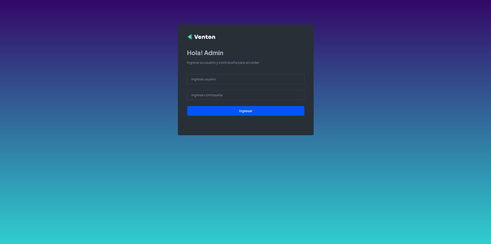
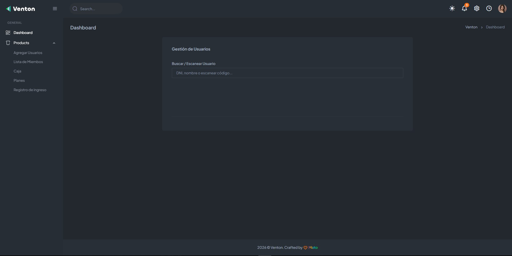
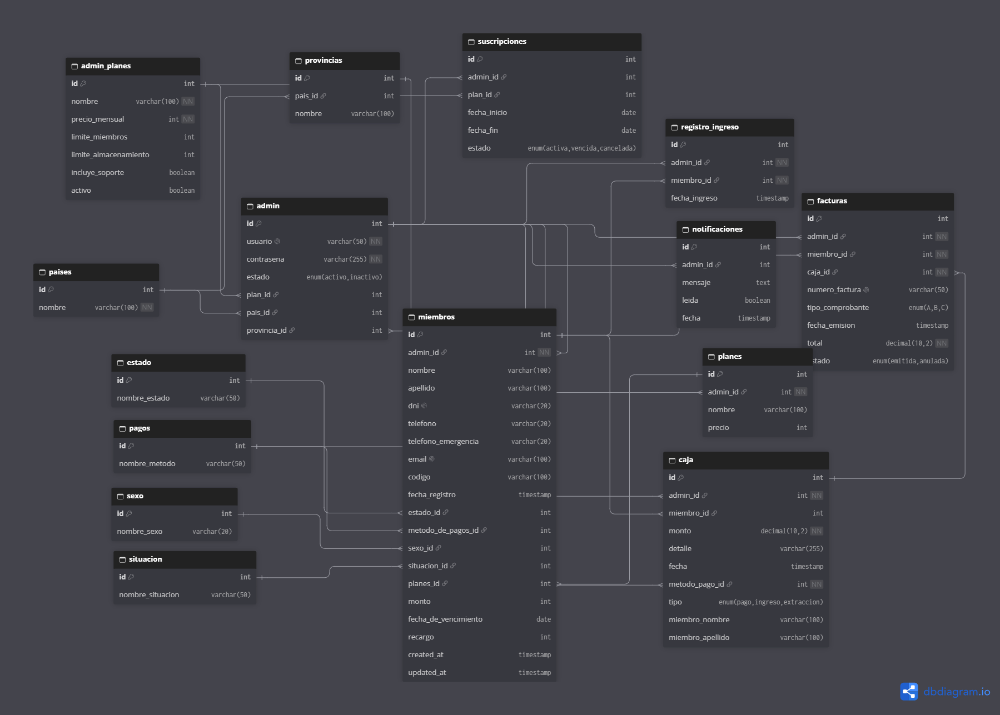

<div align="center">
  
</div>

# Sistema Gym 🏋️

Sistema web de **gestión integral de gimnasio**: socios, planes, pagos con recargo, caja diaria, registros de ingreso y perfiles — todo operable desde un panel con UI clara.

PHP + MySQL clásico (sin framework): lo abrís en XAMPP y anda — pensado para la operación del día a día real del gimnasio.

---

## 🚀 Cómo probarlo

### Requisitos
- **XAMPP** (Apache + MySQL)
- Navegador — nada más.

### Pasos

1. **Cloná el repo** dentro de tu carpeta de Apache:

```bash
cd C:\xampp\htdocs
git clone https://github.com/guille2506/sistema-gym.git
```

2. **Importá la base**: abrí phpMyAdmin (`http://localhost/phpmyadmin`) → importá `gimnasio2.sql` (viene en la raíz del repo). Eso crea la base `gimnasio2` con sus tablas y datos de ejemplo.

3. **Arrancá Apache y MySQL** en el panel de XAMPP y abrí:

```
http://localhost/sistema-gym/
```

> 🔑 La conexión busca `localhost` con usuario `root` sin contraseña (el default de XAMPP) — si configuraste otra cosa, ajustá `conexion.php`.
> Los usuarios se administran desde `AgregarUsuarios.php`; el login te lo pide en el `index.php`.

---

## 🖼️ El sistema por dentro

| Pantallas | Vista principal |
| :---: | :---: |
|  |  |

**Base de datos** — diagrama y modelo con el que labura el sistema:

<p align="center"></p>

---

## 📦 Estructura (a las apuradas)

| Archivo                  | Qué resuelve                                    |
|--------------------------|--------------------------------------------------|
| `index.php`              | Login / puerta de entrada                        |
| `panel.php`              | Home del panel                                   |
| `listas-de-miembros.php` | Socios con paginación y filtros                  |
| `caja.php`               | Caja diaria                                      |
| `PagarRecargo.php`       | Pagos con recargo                                |
| `Registro_ingreso.php`   | Registro de ingresos                             |
| `renovacion.php`         | Renovación de cuotas                             |
| `planes.php` / `perfil.php` | Planes y perfil del socio                     |
| `gimnasio2.sql`          | Import completa de la base                       |
| `conexion.php`           | Conexión MySQL                                   |

🔗 [Ver en mi portfolio](https://nuevoportfolio.vercel.app/works/detail/sg6mvk2jt9/index.html)

---

<p align="center">
  <sub><b>moto</b> · hecho con cariño — <a href="https://nuevoportfolio.vercel.app/">portfolio</a></sub>
</p>
